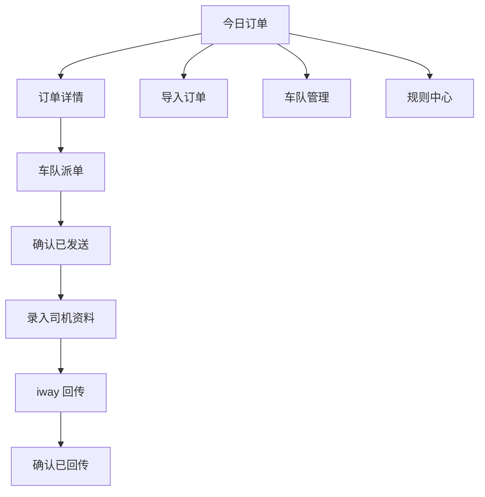

# 接送机发单平台一期：页面原型与交互说明

**版本：** v1.0  
**用途：** 将《一期产品需求文档》落实为开发可执行的页面、按钮与状态变化说明。  
**范围：** 内部运营工作台；一期只生成和复制微信/WhatsApp 文本，最终发送由人工完成。

## 1. 信息架构

左侧固定导航只保留：**今日订单、订单详情、车队管理、规则中心**。订单详情是一张单页工作台，避免在多个页面间来回跳转。

## 2. 今日订单

### 布局

1. 日期范围：默认今天至未来 7 日；提供今天、明天及自定义日期。
2. 统计卡片：待核对、待派车、待司机资料、待回传、异常/逾期。
3. 筛选：服务城市、车队、状态、异常、关键词（订单号/乘客/电话）。
4. 订单表：接客时间、订单号、乘客/路线摘要、车型/车队、状态、异常、下一步。

异常和临近订单置顶，其余按接客时间升序。

### 交互

- “导入新订单”打开三步导入弹窗。
- 每行“下一步”直接定位到订单详情的相应区块：派车、司机资料或回传。
- 多选订单仅能批量生成文本或复制文本；不得批量标记已发送/已完成。
- 异常订单不得被直接批量完成。

## 3. 导入订单弹窗

| 步骤 | 内容 | 关键规则 |
|---|---|---|
| 1. 粘贴原文 | 粘贴飞书整封邮件、esforty 订单文字或手工新增 | 原始文字永久保存 |
| 2. 核对结果 | 左侧可编辑字段，右侧原文；字段旁显示来源片段 | `Departure Time` 标为“接客时间” |
| 3. 查重保存 | 展示同订单号与疑似重复结果 | 人工选择更新/查看/保留双单 |

核心字段不完整时，只能保存为“待核对”；不得进入待派车。

## 4. 订单详情（核心工作台）

| 区块 | 展示内容 | 主按钮 | 成功后的结果 |
|---|---|---|---|
| 状态条 | 状态、接客倒计时、异常、规则版本 | 查看异常 | 定位问题字段或重复单对比 |
| 订单信息 | 标准字段、原始文本、编辑历史 | 保存核对 | 完整则待派车，否则待核对 |
| 车队派单 | 车队选择、统一模板预览 | 生成、复制、已发送给车队 | 最后一步写入快照/时间，变为待司机资料 |
| 司机资料 | 原始回复、翻译、车型图片与结构化字段 | 解析、保存并确认 | 完整则变为待回传平台 |
| iway 回传 | 英文预览与字段校验 | 生成、复制、已回传 iway | 最后一步写入快照/时间，变为已完成 |
| 操作记录 | 操作人、时间、规则版本、文本快照 | 查看快照 | 快照只读，不可覆盖 |

### 防误操作

- “复制”不改变任何订单状态。
- “已发送给车队”“已回传 iway”均需要二次确认，并写入确认时间与文字快照。
- 派单前缺字段、回传前缺司机姓名/电话/车型/车牌时，按钮禁用并明确显示缺失项。
- 无订单号的车队回复必须由用户选择候选订单；唯一候选可以自动预选，但仍必须确认。
- 疑似重复只提醒与对比，不自动合并或取消。

## 5. 车队管理

轻量资料页，仅维护车队名称、服务城市、默认群聊备注、可提供车型、备注与启用状态。

- 城市只服务于筛选和选择提示，**不决定派单格式**。
- 曼谷和苏梅始终共用同一 `dispatch` 模板。
- 车队新增/修改只影响未来订单；历史订单显示当时保存的车队名称。

## 6. 规则中心

### 布局

- 左侧：派单模板、iway 回传、必填校验、电话与车型、时效提醒、重复检测。
- 中间：`business-rules.yaml` 编辑区。
- 右侧：基于一张示例订单的实时派单/回传预览及校验结果。
- 底部：当前版本、发布人、发布时间、历史版本与回退。

### 发布流程

`编辑草稿 → 语法校验 → 字段校验 → 示例预览 → 发布新版本`

- 校验失败时禁止发布，并精确提示行号与原因。
- 新版本只影响之后新生成的派单/回传；旧订单保存原本的 `rules_version` 与文本快照。
- 回退以发布一个引用旧内容的新版本实现，绝不覆盖历史记录。

## 7. 状态与唯一动作

| 当前状态 | 允许的关键动作 | 成功后状态 |
|---|---|---|
| 新订单 / 待核对 | 保存核对 | 待派车或仍待核对 |
| 待派车 | 已发送给车队 | 已派车，待司机信息 |
| 已派车，待司机信息 | 保存并确认司机资料 | 待回传平台 |
| 待回传平台 | 已回传 iway | 已完成 |
| 异常 | 修复缺失/重复/冲突后保存 | 回到对应正常状态 |

状态不能通过普通下拉框任意跳转；每次变化必须进入操作记录。

## 8. 验收补充

1. 看板“下一步”能直达订单详情对应区块。
2. 复制派单后订单仍为待派车，只有确认已发送才进入待司机资料。
3. 规则中心调整字段顺序后，示例预览即时更新；历史快照不变。
4. 曼谷/苏梅订单始终调用同一个 `dispatch` 模板，不存在城市专属分支。
5. 所有完成类按钮均须二次确认，并记录操作时间、规则版本与文本快照。
